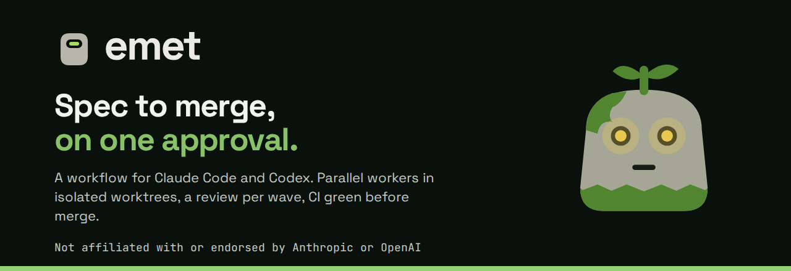

<div align="center">

# emet

<picture>
  <source media="(prefers-color-scheme: dark)" srcset="docs/brand/og/cover.png">
  <source media="(prefers-color-scheme: light)" srcset="docs/brand/og/cover-light.png">
  
</picture>

**Spec to merge, on one approval.**

[](https://github.com/andryorelabs/emet/actions/workflows/ci.yml)
[](https://github.com/andryorelabs/emet/releases)
[](LICENSE)
[](https://scorecard.dev/viewer/?uri=github.com/andryorelabs/emet)

[Website](https://emet.andryore.dev) · [Documentation](docs/README.md)

[Changelog](CHANGELOG.md) · [Contributing](CONTRIBUTING.md) · [Security](.github/SECURITY.md) · [Support](.github/SUPPORT.md)

</div>

emet is a plugin for Claude Code and Codex. It takes a feature from idea to merged change: interview, spec, tickets, one approval, then parallel workers implement and test in isolated worktrees. Each wave gets a review, CI must be green before merge, and nothing merges when something is flagged.

It runs on your machine, in any git repo, with Linear, GitHub Issues or no tracker.

- **One approval.** You review the spec and the tickets once, then the run starts.
- **A review per wave.** A reviewer checks each wave before it lands.
- **Nothing merges when flagged.** A wave with anything flagged is never auto-merged.
- **CI green before merge.** The wave's PR waits for its checks; a failing check is fixed and pushed a bounded number of times, then left open for you.
- **Isolated worktrees.** Each worker implements in its own git worktree, so parallel branches do not touch each other.
- **Your tracker, or none.** Linear, GitHub Issues or local files.

Pronounced "EH-met".

In folklore a golem is a clay figure brought to life by the word _emet_, "truth", written on its forehead.
Erase one letter and it stops; here, nothing merges when something is flagged.

## Quickstart


Requirements: Claude Code or the Codex CLI, `git`, `gh` (authenticated) and the `mattpocock-skills` plugin. Bun is needed only for `emet self install --from`. See [Requirements](#requirements).

1. Install emet. No Bun, clone or sudo needed:

   ```bash
   curl -fsSL https://emet.andryore.dev/install.sh | sh
   ```

   Add `-s -- --dry-run` after `sh` to preview the writes. It installs the terminal `emet`, the Claude Code commands and agents and, when Codex is present, the Codex skills and hooks; on Codex, trust the hooks once with `/hooks` (needs `mattpocock-skills` too; see [Codex](docs/how-to/use-codex.md)). Updates are automatic once a day (`EMET_AUTO_UPDATE=0` turns that off; `emet self update` updates by hand). To remove it, run `emet uninstall` (add `--dry-run` to preview). See the [CLI reference](docs/reference/cli.md#setup-ledger-and-restore) and [Update emet](docs/how-to/update-emet.md).

   Optional: install the plugin instead, for Claude Code or Codex:

   ```bash
   claude plugin marketplace add andryorelabs/emet
   claude plugin install emet@emet-marketplace
   codex plugin marketplace add andryorelabs/emet
   codex plugin add emet@emet-marketplace
   ```

   Optional: a pixel mascot, see [Mascot](#mascot-optional).

2. In your repo, set it up and check it. On Claude Code:

   ```
   /emet:init
   /emet:doctor
   ```

   On Codex:

   ```
   $emet:init
   $emet:doctor
   ```

   In a plain terminal, `emet init` and `emet doctor .` work after the standalone install.

3. Inside Claude Code:

   ```
   /emet:run <describe the feature>
   ```

   On Codex, run the skill `$emet:run <describe the feature>`.

More in [Getting started](docs/start/install.md). If `doctor` reports a problem, see [troubleshooting](docs/troubleshooting.md).

## Requirements

### Supported platforms

Linux and macOS. Windows is supported only through WSL: on native Windows emet shows one notice and stays inactive, and the bootstrap script refuses to run. See [ADR-0007](docs/adr/0007-macos-support.md) and the [dependencies reference](docs/reference/dependencies.md).

## Mascot (optional)


- Claude Code mod: `claude plugin install emet-mascot@emet-marketplace` shows a pixel mascot beside the transcript (or above the prompt, or as a status line) that mirrors your session and the run phase.
- Orca pet: the same character as an Orca pet bundle in `docs/brand/pet/emet/`.

Options and the Orca import are in the [mascot how-to](docs/how-to/mascot.md).

## How it works

1. You describe a feature; `/emet:run` (`$emet:run` on Codex) interviews you and writes a spec.
2. It splits the spec into tickets and asks for one approval.
3. Parallel workers implement each ticket in its own git worktree.
4. A reviewer checks the wave, and CI must be green; anything flagged stops the merge.
5. The wave lands as one PR (or a local merge), and the next wave can chain on.

## Models & effort

On Claude Code, emet picks a model and a reasoning effort per role automatically: Opus plans, Sonnet coordinates and implements, Opus reviews by risk tier, and Haiku triages CI logs. On Codex, it uses the `codex.models` defaults instead. The role table, the `review.highRiskPaths` rule and what you set once are in [Models and effort](docs/how-to/choose-models.md).

## Safety

emet registers a `PreToolUse` guard in [`hooks/hooks.json`](hooks/hooks.json). It runs `emet guard` before every Bash, Skill, ScheduleWakeup and file-edit tool call, and blocks the ones that break the run's rules. See [Security](docs/concepts/security.md) for the threat model.

## Verify a release

Each release publishes the `emet-*` binaries and a `SHA256SUMS` file with build provenance. Download the binary and `SHA256SUMS` from the [release](https://github.com/andryorelabs/emet/releases), then:

```bash
sha256sum -c SHA256SUMS --ignore-missing
gh attestation verify emet-linux-x64 --repo andryorelabs/emet
```

Use the file name of your platform: `emet-linux-x64`, `emet-linux-arm64`, `emet-darwin-x64` or `emet-darwin-arm64`. On macOS use `shasum -a 256 -c SHA256SUMS --ignore-missing`.

## Documentation

- Guide: [getting started](docs/start/install.md), [trackers and landing](docs/how-to/configure-tracker.md), [models and effort](docs/how-to/choose-models.md), [fleet check](docs/how-to/check-a-fleet.md), [Codex](docs/how-to/use-codex.md)
- Reference: [configuration](docs/reference/configuration.md), [CLI](docs/reference/cli.md), [dependencies](docs/reference/dependencies.md)
- Project: [architecture](docs/concepts/architecture.md), [troubleshooting](docs/troubleshooting.md), [documentation index](docs/README.md), [changelog](CHANGELOG.md), [product](PRODUCT.md), [roadmap](ROADMAP.md), [design](DESIGN.md), [accessibility](ACCESSIBILITY.md)

## Contributing

See [CONTRIBUTING.md](CONTRIBUTING.md). Questions go through [SUPPORT.md](.github/SUPPORT.md).

## License

[MIT](LICENSE)

---

Built by [AndryOre](https://andryore.dev)

Not affiliated with or endorsed by Anthropic or OpenAI.
