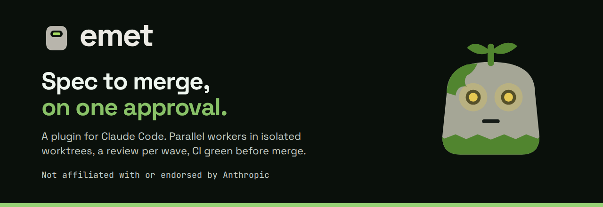

# emet

<picture>
  <source media="(prefers-color-scheme: dark)" srcset="docs/brand/og/cover.png">
  <source media="(prefers-color-scheme: light)" srcset="docs/brand/og/cover-light.png">
  
</picture>

**Spec to merge, on one approval.**

[](https://github.com/andryorelabs/emet/actions/workflows/ci.yml)
[](LICENSE)

Docs: [index](docs/README.md) · [architecture](docs/architecture.md) ·
[troubleshooting](docs/troubleshooting.md) · [changelog](CHANGELOG.md)

Formerly claude-forge.

emet is a plugin for Claude Code. It takes a feature from idea to merged change: interview, spec, tickets, one approval, then parallel workers implement and test in isolated worktrees. Each wave gets a review, CI must be green before merge, and nothing merges when something is flagged.

It runs on your machine, in any git repo, with Linear, GitHub Issues or no tracker.

- **One approval.** You review the spec and the tickets once, then the run starts.
- **A review per wave.** A reviewer checks each wave before it lands.
- **Nothing merges when flagged.** A wave with anything flagged is never auto-merged.
- **CI green before merge.** The wave's PR waits for its checks; a failing check is fixed and pushed a bounded number of times, then left open for you.
- **Isolated worktrees.** Each worker implements in its own git worktree, so parallel branches do not touch each other.
- **Your tracker, or none.** Linear, GitHub Issues or local files.

Pronounced "EH-met".

In folklore a golem is a clay figure brought to life by the word _emet_, "truth", written on its forehead.
Erase one letter and it stops; here, nothing merges when something is flagged.

Not affiliated with or endorsed by Anthropic

## Install

Requirements: Claude Code, `git`, `gh` (authenticated) and the
`mattpocock-skills` plugin, on Linux or macOS. Bun is needed only for a source
install; native Windows is unsupported (use WSL).

There are two install paths.

**Plugin, from a private marketplace** (no Bun needed). Add this repo as a
marketplace and install the `emet` plugin; it brings `/emet:run`, the
agents, the guard hooks and an `emet` shim that downloads a checksum-verified
standalone binary on first use.

**`install.sh`** (works with or without Bun):

```bash
git clone git@github.com:andryorelabs/emet.git
cd emet
./install.sh
```

With `bun` on PATH it copies the CLI source to `~/.claude/emet` and an `emet`
wrapper to `~/.local/bin/emet`. Without `bun` it installs the standalone-binary
shim instead (`~/.local/bin/emet`, linked to `~/.claude/emet/bin/emet`),
which downloads and checksum-verifies the binary on first run (needs `curl`).
Either way the command lands in `~/.claude/commands/emet.md` and the agents in
`~/.claude/agents/`; plugin placeholders in the prompts are rewritten to plain
`~/.claude` paths and `/emet`. Re-running it is safe, and a file you edited is
kept with the new version written beside it as `<file>.new`.

Recommended order, in each repo: run `/setup-matt-pocock-skills` first, then
`emet init`.


Verify it worked (`selftest` needs a source install):

```bash
emet doctor .
```

## Dependencies

- **[bun](https://bun.sh)** — only for source installs; the standalone binary
  needs no runtime.
- **`rsync`** and **`sha256sum` or `shasum`** — required by `install.sh`.
- **`git`** — required at runtime; nearly every subcommand shells out to it.
- **`gh` CLI, authenticated** — required for every tracker kind (PRs always
  use it).
- **The `mattpocock-skills` plugin** (`claude-plugins-official` marketplace)
  — `/emet`'s interview/spec/ticket phases call skills that live there.
  ```
  claude plugin marketplace add anthropics/claude-plugins-official
  claude plugin install mattpocock-skills@claude-plugins-official
  ```
- **The `emet-worker` and `emet-reviewer` agents** in `~/.claude/agents/`
  — installed by `install.sh` (see "Models & effort" below); Phase 6 and
  Phase 8 dispatch by `subagent_type`, so either one missing breaks dispatch.
- **A Linear MCP server declared in `.mcp.json` (or at user scope)** — only
  if the repo uses the `linear` tracker. Declaration is what gets verified;
  whether the connection is actually _authenticated_ lives in Claude Code's
  own credential store and can't be checked from here — if a run fails to
  read tickets, restart Claude Code and approve the connection.

None of the above is ever installed or logged in on your behalf. What
changed is _who checks it and how hard_:

|                                                  | `emet init`                | `emet doctor`                 | `emet preflight`                                                          |
| ------------------------------------------------ | -------------------------- | ----------------------------- | ------------------------------------------------------------------------- |
| plugin missing/disabled                          | prints the install command | reports it (once, fleet-wide) | **blocks dispatch**                                                       |
| `emet-worker`/`emet-reviewer` agent missing      | —                          | reports it (once, fleet-wide) | **blocks dispatch**                                                       |
| `gh` missing/unauthenticated (tracker: `github`) | prints what to run         | reports it                    | **blocks dispatch**                                                       |
| Linear server undeclared (tracker: `linear`)     | prints a note              | reports it                    | **blocks dispatch**                                                       |
| `claude` not on PATH, or a probe timing out      | prints a note              | reports it                    | **warns, never blocks** — this is "couldn't check", not "verified broken" |
| a flag emet relies on missing from `--help`      | —                          | reports it                    | —                                                                         |

`emet doctor` checks the flags themselves, not only that the binaries exist.
It reads `--help` for `gh issue view`/`gh repo view` (`--json`),
`gh issue edit` (`--add-label`, `--remove-label`), `claude` (`--bg`) and
`claude agents` (`--json`), and reports any flag a newer or older CLI no
longer documents. A renamed flag would otherwise fail a wave midway.

Every probe is capped at 5s so a stalled `gh auth status` (no network) can't
hang a wave. If a `preflight` block is itself wrong for your environment,
`EMET_SKIP_DEPENDENCY_CHECKS=1 emet preflight` downgrades it to a warning
for that one run — set it in your own shell, not in anything the `/emet`
coordinator runs unattended.

A repo's `preflight.requiredCommands` (in `emet.config.json`) is a separate,
repo-owned list of binaries `emet preflight`/`emet doctor` require on PATH
— useful for `rg`/`sg`, which the worker prompts offer as faster alternatives
to reading a file whole. `gh` doesn't need to be listed there; the check
above already covers it.

## Use

In any git repo:

```bash
emet init          # autodetects package manager, trunk branch, tracker kind
emet preflight      # confirms the repo is dispatch-ready
```

Then, inside Claude Code:

```
/emet <describe the feature>              # interview → wave 1; later waves via --dispatch/autoChain
/emet --draft <describe the feature>      # stop after tickets are created
/emet --dispatch <spec-id>                # dispatch a --draft'd spec later
```

`emet init` leaves a `TODO(emet):` marker in the generated
`docs/agents/*.md` files for anything it can't infer on its own (a shared
test-database lock, schema ownership, etc.) — fill those in; `emet
preflight` refuses to dispatch while one remains.

### Landing PRs and chaining waves

One wave is one PR. Its body carries `Closes #N` for each ticket (the
tracker's closing keyword), and the coordinator moves the tickets to in-review
when it opens the PR. The PR is then merged per `pr.autoMerge`, or left open
when the wave was flagged, `autoMerge` is `false`, or CI fixes ran out (the PR
then gets the human-decision label). After a merge, `emet cleanup --run
<runId>` frees the wave's branches, ticket claims, and worker slots. Later
waves run in their own sessions, never in the one that ran wave 1. Two optional
`emet.config.json` sections control
what happens next (both validated by `emet preflight`):

```json
{
  "pr": { "autoMerge": true, "mergeMethod": "squash", "maxCiFixAttempts": 2 },
  "handoff": {
    "autoChain": false,
    "launcher": "auto",
    "permissionMode": "bypassPermissions"
  }
}
```

- `pr.autoMerge` (default `true`): wait for the PR's checks and merge; with no
  checks, merge at once. A failing check is fixed and pushed, up to
  `maxCiFixAttempts` times, then the PR is left open for a human. A wave with
  anything flagged is never auto-merged.
- `handoff.autoChain` (default `false`): after a clean, merged wave with more
  waves left, launch the next one with `claude --bg` instead of printing
  `/emet --dispatch <spec-id>`. Inspect it with `claude agents` /
  `claude attach emet-<spec-id>-w<n>`. Requirements:
  1. `claude` on PATH, with `--bg` support.
  2. A trusted workspace. `--bg` runs non-interactively, so the trust dialog
     never shows; open `claude` interactively in the repo once and accept it.
  3. The bypass warning accepted once in an interactive session
     (`skipDangerousModePermissionPrompt`), since the next wave runs in
     `handoff.permissionMode` (below), not in the launching session's mode.

  It launches only when the PR merged and nothing was flagged, and it skips
  if a `emet-<spec-id>-*` session is already live (`claude agents --json`).
  If the launch fails, it falls back to printing `/emet --dispatch <spec-id>`.

- `handoff.launcher` (default `auto`): also open the wave in an Orca tab
  running `claude attach`. `auto` asks the Orca runtime (`orca status`), so it
  works from `claude --bg` sessions too, which have no `TERM_PROGRAM`; `orca`
  always tries, `bg` never. The wave runs in the background either way, and a
  tab that fails to open never stops the chain.

  `emet launch <spec-id> --wave <n>` does the whole launch (duplicate-session
  check, `claude --bg`, tab) and prints
  `{ name, id, attach, orcaTab: { opened, reason } }`. Use it, not a bare
  `claude --bg`, whenever you want a wave in another session by hand.

- `handoff.permissionMode` (default `bypassPermissions`): permission mode of
  the chained session. Not inherited from the launching session, because
  `auto` mode's classifier can deny a step such as `gh pr merge` and leave a
  wave half-finished. Your `permissions.deny` rules still apply, but the
  bypass warning must have been accepted once interactively
  (`skipDangerousModePermissionPrompt`).

### Local tracker and local landing

With `tracker.kind: "local"`, specs and tickets are markdown files under the
main worktree's `.scratch/` (not versioned): `.scratch/<slug>/spec.md` and
`.scratch/<slug>/issues/<NN>-<slug>.md`, each with `Status:` and `Blocked by:`
lines and comments under `## Comments`. The coordinator reads and writes them
through `emet tracker` (`create-spec`, `create-ticket`, `read`, `frontier`,
`set-state`, `comment`, `close`). `emet init --tracker local` sets this up. See
[ADR-0011](docs/adr/0011-local-tracker-scratch-convention.md).

`landing.mode` is `"pr"` (default) or `"merge"`, independent of the tracker. In
`merge` mode a wave lands as one local merge into trunk with `emet land`, with
`commands.selfCheck` standing in for CI and no push. `gh` is only required when
the tracker is `github` or landing is `pr`. See
[ADR-0010](docs/adr/0010-local-merge-landing.md).

## Gates, budgets and records


The phases don't decide on their own when a ticket is done, mergeable or
worth retrying. They call a CLI command that reads a record on disk and
prints the decision. Run records live under `.emet/runs/<run-id>/` and the
review ledger under `.emet/review/`, in the main checkout, not in a worker's
worktree. Every command prints its usage with `--help`.

| Step              | Command                                              | What it enforces                                                                                                                                                                                                                                             |
| ----------------- | ---------------------------------------------------- | ------------------------------------------------------------------------------------------------------------------------------------------------------------------------------------------------------------------------------------------------------------ |
| Before approval   | `emet validate --file <plan.json>`                   | Every `S#` is covered by at least one ticket and has an acceptance scenario. Every ticket covers at least one `S#`. Edit surfaces are disjoint within a wave. No dependency cycles. `emet preflight` runs it again on the approved plan.                     |
| Approval          | `emet approve --run <id> --spec <file>`              | Writes `approval.json` with the spec and ticket-list hashes. Dispatch refuses if either changed afterwards (`--check`).                                                                                                                                      |
| Ticket creation   | `emet materialize-log --run <id> --record/--lookup`  | Saves each created ticket's ID as soon as it exists, so an interrupted run never creates duplicates.                                                                                                                                                         |
| Worker done       | `emet results --run <id> --write/--read <ticket>`    | Workers write a local result file (`DONE`, `DONE_WITH_CONCERNS`, `BLOCKED` or `NEEDS_CONTEXT`, plus a `Risk:` line). Only the coordinator writes to the tracker.                                                                                             |
| After each worker | `emet verify <ticket> --run <id>`                    | Checks that commits exist beyond the dispatch baseline, every changed path is inside the ticket's edit surfaces, the handoff note passes `handoff --check`, and `commands.workerScopedSuite` passes. Review and merge refuse a ticket without a pass record. |
| Review input      | `emet review-package <base> <head> --out <file>`     | Bundles the diff for the reviewer, who receives it as a file path. Exits 3 if the range is empty or not a descendant of base.                                                                                                                                |
| Review            | `emet review --ticket <t> --findings <file>`         | Keeps the findings ledger and enforces triage order (`intent_gap` → `bad_plan` → `patch` → `defer`) and the round cap. `--escalate` moves to the next model tier. `--rule`/`--rulings` record and list the "Rulings I made" for the report and the PR body.  |
| Merge or chain    | `emet gate <ticket> --tier … --ci … --integration …` | Prints `merge`, `hold`, `chain`, `stop` or `defer` as JSON with its reasons. It reads the verify record, the open findings, the risk tier, CI, the integration suite and the budgets.                                                                        |

After a wave's branches are merged together, `commands.fullSuite` runs once
on the integration branch. A red run blocks the PR and `autoChain`. The gate
receives the result as `--integration`.

**Budgets** (`emet.config.json`, all optional):

```json
{ "budgets": { "workerAttempts": 2, "reviewRounds": 2, "stallNudgeCap": 6 } }
```

- `workerAttempts`: how many times a ticket can fail `verify` before the gate
  answers `defer`. The ticket gets the deferred label and the rest of
  the wave continues. An environment fault, such as the test command exiting
  126/127 or a provider outage, pauses the run without spending an attempt.
- `reviewRounds`: how many review/fix rounds a ticket gets before one
  escalation to the next model tier. Whatever is still open after that gets a
  ruling.
- `stallNudgeCap`: how many times a stalled worker gets nudged. The count
  never resets.

**Living specs.** After a wave auto-merges, `emet spec-merge --spec <id>`
merges the spec's `ADDED`/`MODIFIED`/`REMOVED` requirement deltas into
`docs/specs/<area>.md` (`specs.dir`). It checks every area before writing
anything. A conflict, or a requirement that would lose a scenario, exits 1
and leaves every file untouched.

**Codebase map.** `emet map` writes a brief of an existing codebase (stack,
structure, conventions, testing, hotspots) to `docs/agents/codebase.md`
(`map.path`), stamped with the commit SHA it was built from. The same commit
always produces the same file. `emet map --stale` exits 1 once HEAD has
moved past the stamp, and `emet preflight` warns in that case.
`emet map --for <globs>` prints only the sections that match a ticket's
edit surfaces. That output is the only part of the map a worker brief
includes.

**Metrics.** `emet metrics --run <id>` reports tokens, API-equivalent cost
and wall time per ticket, per wave and per run, read from the session
transcripts. It also compares the context budget estimated per ticket with
what each worker actually used. Its summary goes at the end of the run's
final report.

## What's in here

- `emet/` — the CLI (`emet init/doctor/preflight/claims/slots/cleanup/
  usage/handoff/launch/lock-reason/assess/status/surfaces/validate/approve/
  materialize-log/results/verify/review-package/review/gate/spec-merge/map/
  metrics/guard/selftest`), its schema, and the doc templates `emet init`
  fills in. `install.sh` also wires `emet guard` in
  as a Claude Code `PreToolUse` hook (`~/.claude/settings.json`) that blocks
  a handful of known, unattended-run failure triggers (see
  `emet/src/guard.ts`) regardless of whether the current session's context
  happens to include the doc that already asks not to do them.
- `commands/emet.md` — the `/emet` command itself (a ~110-line router);
  everything else it needs lives in `emet/reference/`, loaded only when the
  current run's mode needs it. Each reference file is a separate phase group
  (`phases-1-5.md`, `phases-6-7-dispatch.md`, `phases-8-closeout.md`,
  `phases-9-handoff.md`). A test fails if any of them grows past 20,000 bytes,
  so a single file can't take over the context after compaction. The phases
  tell the coordinator to re-read the relevant section before each fix or
  review round. `install.sh` moves the old single `phases-6-9.md` aside as
  `phases-6-9.md.retired` when you edited it or it predates the install
  manifest. Otherwise it deletes it.

## Models & effort

`/emet` picks a model and a reasoning effort per role automatically —
nothing to switch by hand mid-run:

| Role                                           | Model                  | Effort              | Set by                                      |
| ---------------------------------------------- | ---------------------- | ------------------- | ------------------------------------------- |
| Planning (Phases 1–4)                          | Opus, via `opusplan`   | your session's      | you, once                                   |
| Coordinator, Phase 5 on                        | Sonnet, via `opusplan` | your session's      | you, once                                   |
| Workers (Phase 7)                              | Sonnet                 | `medium`            | `agents/emet-worker.md`, or `models.worker` |
| Review, `passive` tier (docs-only diff)        | none                   | —                   | `emet assess`                               |
| Review, `medium` tier (ordinary source change) | Opus                   | `medium`            | `models.reviewer.medium`                    |
| Review, `high` tier (risky paths or sinks)     | Opus                   | `medium` by default | `models.reviewer.high`                      |
| CI-log triage (Phase 8)                        | Haiku                  | —                   | `models.triage`                             |

The two agent definitions (installed by `install.sh` to `~/.claude/agents/`)
pin their own `model`/`effort` in frontmatter, so the coordinator's own
model/effort choice never leaks into a worker or the reviewer. `emet doctor`
reports (never blocks on) either file going missing.

**Risk-tier routing.** Phase 8 runs `emet assess --base <trunk> --head
<integration branch>`, which classifies the diff deterministically and prints
JSON with the tier, the reasons and the recommended reviewer model/effort:

- `passive` — docs-only diff: no reviewer is dispatched.
- `medium` — the reviewer runs on `models.reviewer.medium`.
- `high` — the diff touches auth, security, payments, webhooks, CI, the
  installer, lockfiles, migrations, a dangerous sink (raw SQL, pipe-to-shell
  and the like) or a path matching `review.highRiskPaths`. The reviewer runs on
  `models.reviewer.high`, and auto-merge lands the PR only with green checks
  and no open review finding.

A ticket that touches high-risk paths can carry a `Model:` line (for example
`Model: opus` or `Model: opus/high`), which overrides `models.worker` for that
worker only.

**Haiku triage.** The coordinator never reads a CI log whole. A failing check
is handed to an agent on `models.triage` (default `haiku`), which returns at
most about 2k tokens with `file:line` pointers for the fix.

**Config.** Every key is optional, and the defaults reproduce the table above:

```json
{
  "models": {
    "worker": { "model": "sonnet", "effort": "medium" },
    "reviewer": {
      "medium": { "model": "opus", "effort": "medium" },
      "high": { "model": "opus", "effort": "medium" }
    },
    "triage": "haiku"
  },
  "review": { "highRiskPaths": [] }
}
```

`review.highRiskPaths` is a list of extra case-insensitive path substrings that
force the `high` tier. To get more scrutiny on risky waves, raise
`models.reviewer.high.effort` (for example to `high`).

Why a single fresh-context reviewer instead of a multi-angle fan-out: no
public benchmark compares the two directly, but a fan-out re-reads the whole
diff once per angle and has hung for over an hour in this repo, while
Anthropic and third-party reports on Opus-tier models suggest the model
upgrade buys as much as the extra angles would. For a high-stakes wave, run
`/code-review ultra` by hand afterward — `/emet` never dispatches that on
its own.

**What you set once, yourself** — `/emet` can't switch these mid-run:

- `model: "opusplan"` in `~/.claude/settings.json` — this is what makes
  Phases 1–4 run on Opus and Phase 5 onward run on Sonnet, with no `/model`
  needed. `emet doctor` warns (never edits your settings) if it's unset.
- A session effort of `medium` or `high` rather than `xhigh` — the workers
  and reviewer already carry their own effort regardless of yours, and a
  high global default mostly adds cost to the coordinator's own turns
  (dispatch bookkeeping, merges, reports) that don't need it.
- `permissions.defaultMode` able to run unattended (`auto`, `acceptEdits`,
  or `bypassPermissions`), plus `permissions.deny` rules blocking
  `git push * main|master` and `git push --force *` — `emet doctor` warns
  on both, since a wave that stalls on a permission prompt or that can force
  its way past the trunk branch defeats the point of running unattended.

These are starting points, not settled numbers — Opus 5.5 launched
2026-09-22, and effort/model choice for coding agents is still an active
area; re-tune after a few real waves rather than treating this table as
final.

## Fleet check

Already using this across several repos? `emet doctor` audits any number of
them at once, read-only:

```bash
emet doctor ~/code/*
```

Reports, per repo: valid `emet.config.json`, all four `docs/agents/*.md`
files present, zero leftover `TODO(emet):` markers, whether the commands in
`commands.selfCheck` actually resolve, and that repo's tracker-specific
dependency findings (`gh`, Linear — see Dependencies above). The
mattpocock-skills plugin and the external CLI flags (`gh`, `claude --bg`,
`claude agents --json`, checked via `--help`) are checked once for the
whole sweep, not per repo.
